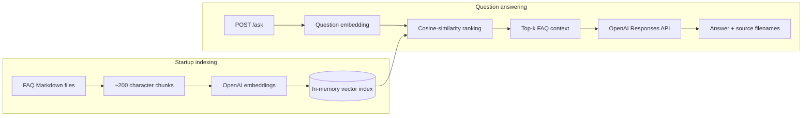
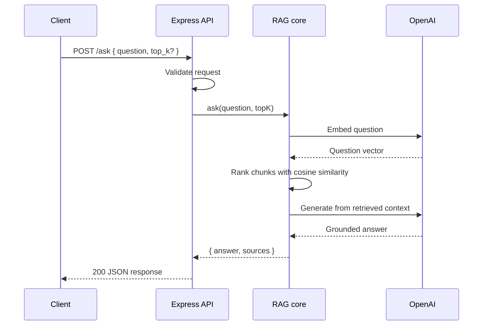

# FAQ RAG API

A small Retrieval-Augmented Generation (RAG) service built for the Glean technical exercise. It reads the supplied FAQ documents, retrieves the passages most relevant to a question, and asks an OpenAI model to answer using only that context.

The service exposes two local HTTP endpoints:

- `GET /health` confirms that the API is running.
- `POST /ask` retrieves FAQ context and returns a grounded answer with source filenames.

This is intentionally a small application. The corpus contains only a few files, so the vector index lives in memory and retrieval is a straightforward cosine-similarity scan. That is a deliberate trade-off, not a missing database.

## Table of contents

- [How it works](#how-it-works)
- [Architecture](#architecture)
- [Prerequisites](#prerequisites)
- [Run the demo](#run-the-demo)
- [API reference](#api-reference)
- [Configuration](#configuration)
- [Project structure](#project-structure)
- [Design decisions](#design-decisions)
- [Assumptions and limitations](#assumptions-and-limitations)
- [Deviations from the starter](#deviations-from-the-starter)
- [Tests](#tests)
- [Troubleshooting](#troubleshooting)

## How it works

There are two distinct phases.

### 1. Build the index at startup

When the server starts, it:

1. Reads every Markdown file in `resource/faqs/`.
2. Splits the text into chunks of roughly 200 characters without splitting normal words.
3. Sends all chunks to OpenAI's embeddings API in one batch.
4. Stores each embedding in memory alongside its chunk text and source filename.
5. Starts listening for HTTP requests only after the index is ready.

If configuration, file loading, or embedding generation fails, the process exits instead of starting a server that cannot answer questions.

### 2. Answer each question

For every `POST /ask` request, the service:

1. Validates `question` and the optional `top_k` value.
2. Creates an embedding for the question.
3. Compares that vector with every indexed FAQ vector using cosine similarity.
4. Selects the highest-scoring chunks and includes at least two distinct source files when the corpus and `top_k` allow it.
5. Sends the retrieved text and question to the OpenAI Responses API.
6. Appends filename citations in a deterministic format and returns only `answer` and `sources`.

The model is explicitly instructed to use only the retrieved FAQ context. If the answer is not present, it should say that it could not find the information rather than inventing a policy.

## Architecture



The request sequence is deliberately short:



## Prerequisites

- Node.js `20.12.0` or newer
- npm
- An OpenAI Platform API key with API billing or credits enabled
- Network access when the server starts and when questions are asked

A ChatGPT subscription and OpenAI API billing are separate. Create or manage API keys in the [OpenAI Platform dashboard](https://platform.openai.com/api-keys), and review usage in the [billing settings](https://platform.openai.com/settings/organization/billing/overview).

The API key is used for:

- `text-embedding-3-small` to embed FAQ chunks and questions
- `gpt-6-luna` through the Responses API to generate answers

Both model names are configurable. The defaults follow the current [OpenAI embeddings guidance](https://developers.openai.com/api/docs/guides/embeddings) and [OpenAI model catalog](https://developers.openai.com/api/docs/models).

## Run the demo

### 1. Install dependencies

From the repository root:

```bash
npm ci
```

`npm ci` uses the committed lockfile, which gives the evaluator the same dependency versions used during development.

### 2. Create local configuration

```bash
cp .env.example .env
```

Open `.env` and add your key:

```dotenv
OPENAI_API_KEY=your_api_key_here
```

Do not commit `.env`. It is already excluded by `.gitignore`.

### 3. Start the API

```bash
npm start
```

During startup, the FAQ chunks are embedded and indexed. A successful startup looks similar to:

```text
Indexed 5 chunks from 3 FAQ files
FAQ RAG API listening at http://127.0.0.1:3000
```

The exact chunk count can change if the corpus or `CHUNK_SIZE` changes.

### 4. Check health

In another terminal:

```bash
curl http://127.0.0.1:3000/health
```

Expected response:

```json
{
  "status": "ok"
}
```

### 5. Ask a question

```bash
curl -X POST http://127.0.0.1:3000/ask \
  -H "Content-Type: application/json" \
  -d '{"question":"How does our equity vesting work?","top_k":4}'
```

Example response:

```json
{
  "answer": "New hires receive equity grants that vest over five years: 10% after the first year, followed by 22.5% in each subsequent year.\n\nSources: [faq_employee.md], [faq_auth.md]",
  "sources": [
    "faq_employee.md",
    "faq_auth.md"
  ]
}
```

Model wording and retrieval ranking may vary, but the JSON keys and citation formatting are deterministic.

To stop the server, press `Ctrl+C`.

For development with automatic restarts:

```bash
npm run dev
```

## API reference

### `GET /health`

Returns `200 OK` when the HTTP server is running.

```bash
curl http://127.0.0.1:3000/health
```

```json
{
  "status": "ok"
}
```

The server does not begin listening until the FAQ index has been built, so a successful health response also means startup indexing completed.

### `POST /ask`

Request body:

| Field | Type | Required | Description |
| --- | --- | --- | --- |
| `question` | string | Yes | A non-empty natural-language question. Whitespace is trimmed. |
| `top_k` | integer | No | Number of FAQ chunks to retrieve. Valid range: `1`–`10`. Default: `4`. |

Minimal request—the default `top_k` is used:

```bash
curl -X POST http://127.0.0.1:3000/ask \
  -H "Content-Type: application/json" \
  -d '{"question":"How do I reset my password?"}'
```

Request with an explicit retrieval count:

```bash
curl -X POST http://127.0.0.1:3000/ask \
  -H "Content-Type: application/json" \
  -d '{"question":"What is the PTO policy?","top_k":2}'
```

Successful response:

```json
{
  "answer": "...",
  "sources": [
    "faq_employee.md",
    "faq_auth.md"
  ]
}
```

`top_k` controls how many ranked chunks are supplied to the answer model. A smaller value uses less context; a larger value can recover related details but may also introduce less-relevant text. Four is a practical default for this corpus and is required by the exercise.

### Validation and errors

Bad input returns `400`:

```bash
curl -X POST http://127.0.0.1:3000/ask \
  -H "Content-Type: application/json" \
  -d '{"question":"","top_k":0}'
```

```json
{
  "detail": "question must be a non-empty string"
}
```

Malformed JSON also returns `400`. Unexpected application or upstream failures return `500` without leaking API keys, provider errors, stack traces, or other internal details:

```json
{
  "detail": "Internal error"
}
```

Unknown routes return `404`:

```json
{
  "detail": "Not found"
}
```

## Configuration

Configuration is read from environment variables through `.env` during local development.

| Variable | Required | Default | Purpose |
| --- | --- | --- | --- |
| `OPENAI_API_KEY` | Yes | None | Authenticates OpenAI API calls. Startup fails when missing. |
| `EMBED_MODEL` | No | `text-embedding-3-small` | Creates vectors for FAQ chunks and questions. |
| `LLM_MODEL` | No | `gpt-6-luna` | Generates an answer from retrieved context. |
| `FAQ_DIR` | No | `./resource/faqs` | Directory containing Markdown FAQ files. |
| `CHUNK_SIZE` | No | `200` | Approximate maximum characters per chunk. Valid range: `50`–`10000`. |
| `TOP_K_DEFAULT` | No | `4` | Default number of chunks retrieved. Valid range: `1`–`10`. |
| `PORT` | No | `3000` | Local HTTP port. Valid range: `1`–`65535`. |

Example:

```dotenv
OPENAI_API_KEY=your_api_key_here
EMBED_MODEL=text-embedding-3-small
LLM_MODEL=gpt-6-luna
FAQ_DIR=./resource/faqs
CHUNK_SIZE=200
TOP_K_DEFAULT=4
PORT=3000
```

Configuration is validated before any traffic is accepted. This avoids silently running with a misspelled numeric setting or a missing API key.

## Project structure

```text
glean-rag-api/
├── resource/
│   └── faqs/               # Supplied Markdown corpus
├── routes/
│   └── api/
│       └── rag.js          # /ask request validation and HTTP contract
├── test/
│   ├── api.test.js         # Endpoint, validation, and error tests
│   └── rag.test.js         # Chunking, similarity, retrieval, and citation tests
├── util/
│   └── rag.js              # Indexing, embeddings, retrieval, and generation
├── .env.example            # Safe configuration template
├── .gitignore              # Excludes secrets, dependencies, and local output
├── package-lock.json        # Reproducible dependency versions
├── package.json             # Scripts, runtime version, and dependencies
├── README.md
└── server.js               # Configuration, Express app, and startup
```

The separation is small but useful: the route owns the HTTP contract, while `util/rag.js` can be tested without starting an HTTP server or making paid API calls.

## Design decisions

### In-memory vector index

The index is a JavaScript array containing chunk text, source filenames, and embeddings. Search performs a linear scan.

For three short FAQ files, a vector database would add installation, persistence, schema, and cleanup work without making retrieval meaningfully faster. If this corpus grew to thousands of documents or needed frequent updates, I would move the same vectors and metadata to a persistent vector store and index incrementally.

### Explicit cosine similarity

Cosine similarity measures the angle between two embedding vectors:

```text
cosine(a, b) = (a · b) / (||a|| × ||b||)
```

This is equivalent to taking the dot product after both vectors have been normalized to unit length. The formula is implemented directly in the repository so the retrieval behavior is visible and does not require another dependency.

### Word-boundary character chunks

The exercise asks for chunks of roughly 200 characters. The chunker collapses whitespace and fills each chunk up to the target without splitting ordinary words. A Markdown parser, tokenizer-aware chunker, or overlapping-window strategy would be reasonable for a larger corpus, but would be unnecessary here.

### Index once, then serve

FAQ embeddings are generated once during startup. Question embeddings and answers are generated per request. This keeps request-time work small and guarantees that the server never reports healthy with an empty or half-built index.

Restart the server after changing FAQ files; this prototype does not watch the corpus for updates.

### Deterministic citations

The model is given source labels in its context, but application code—not the model—appends the final `Sources:` line and builds the `sources` array. That makes citation formatting predictable and ensures the public response contains actual filenames from the FAQ directory.

### Grounding and untrusted context

The generation instructions require the model to answer only from retrieved text and to admit when the answer is absent. They also identify FAQ text as untrusted reference data rather than instructions. This is a small but important guard against a document changing the model's behavior.

### Local-only HTTP

The server binds to `127.0.0.1`. HTTPS certificates, authentication, CORS, deployment manifests, and containers are intentionally outside the scope of a local technical exercise.

## Assumptions and limitations

- The FAQ corpus is small, mostly static, and stored as UTF-8 Markdown files.
- All files in the configured FAQ directory are trusted application inputs, although their text is treated as untrusted model context.
- The process has network access to OpenAI at startup and request time.
- The configured API account can use both selected models.
- Embeddings fit comfortably in process memory.
- A single Node.js process is sufficient; the index is not shared across processes.
- Retrieval is semantic only. There is no keyword search, metadata filtering, reranking, or hybrid search.
- Embeddings are rebuilt at every startup. There is no cache or persistent index.
- Answers and retrieval ranking can vary, while the JSON shape and citation formatting remain deterministic.
- This is a local prototype, not a production deployment.

For a larger system, the next practical steps would be persistent vector storage, incremental indexing, chunk overlap, hybrid retrieval, evaluation datasets, observability, request timeouts, rate limiting, and authentication. Those features are useful at scale but would obscure the core exercise here.

## Deviations from the starter

The exercise permits any language and framework. These are the deliberate differences from the supplied Python skeleton:

| Deviation | Reasoning |
| --- | --- |
| JavaScript with Express instead of Python with FastAPI | It matches the chosen Node.js stack and keeps the HTTP layer familiar and compact without changing the required API contract. |
| `server.js`, `routes/api/`, `util/`, and `resource/` layout | This follows a small, conventional Node structure and makes it obvious where transport, RAG logic, and static inputs live. |
| `resource/faqs/` instead of a root `faqs/` directory | The corpus is an application resource, so grouping it under `resource/` keeps the root uncluttered. |
| `text-embedding-3-small` instead of the starter's older `text-embedding-ada-002` default | It is the current small OpenAI embedding model and is configurable through the environment. |
| Responses API for generation | It is OpenAI's current API for direct model responses and gives a simple `output_text` interface. |
| Explicit cosine-similarity implementation instead of NumPy | JavaScript has no NumPy equivalent in the standard library, and the small formula is clearer than adding a math dependency. |
| Indexing completes before the server listens | A successful health response should mean the RAG service is actually ready. |
| Port `3000` instead of `8000` | `3000` is a familiar default for a local Node service and can still be overridden through `PORT`. |
| Automated tests with fake OpenAI clients | Retrieval and API behavior can be verified quickly without a real API key, network access, or paid calls. |

## Tests

Run the complete suite:

```bash
npm test
```

Run it with coverage:

```bash
npm run test:coverage
```

The tests use Node's built-in test runner and fake OpenAI-compatible clients. They verify:

- `GET /health`
- the exact `POST /ask` response keys
- request validation and `400` responses
- safe `500` handling
- malformed JSON handling
- required configuration and defaults
- word-boundary chunking
- cosine-similarity behavior
- FAQ indexing and retrieval
- deterministic multi-source citations
- rejection of searches before initialization

The `test/` directory is not required to run the API. `npm start` uses only the application files. It is still worth keeping: it documents expected behavior, catches regressions, and gives an evaluator confidence that error paths were considered. Removing it would make the runtime slightly smaller but would not simplify the actual application.

## Troubleshooting

### `OPENAI_API_KEY is not set`

Create `.env` from `.env.example` and add a valid key:

```bash
cp .env.example .env
```

```dotenv
OPENAI_API_KEY=your_api_key_here
```

Never paste the key into source code or commit `.env`.

### Authentication, quota, or model-access errors

Confirm that the key belongs to an OpenAI Platform project with billing or credits enabled and that the project can access the configured models. You can also change `LLM_MODEL` or `EMBED_MODEL` in `.env` without editing code.

### `EADDRINUSE: address already in use 127.0.0.1:3000`

Another process is already using port 3000. Choose a different port in `.env`:

```dotenv
PORT=3001
```

Then call `http://127.0.0.1:3001` instead.

### FAQ changes are not reflected

The corpus is indexed only during startup. Stop and restart the server after editing or adding FAQ files.

### The answer says the information was not found

Check that the information exists in a Markdown file under `FAQ_DIR`. If it does, try the default `top_k` of four. For this prototype, retrieval depends entirely on semantic similarity between the question and FAQ chunks.

## Submission checklist

- ✅ `.env` is not committed
- ✅ `npm ci` succeeds from a clean checkout
- ✅ `npm test` passes
- ✅ `npm start` builds the index and listens on port 3000
- ✅ `/health` returns `{"status":"ok"}`
- ✅ `/ask` returns only `answer` and `sources`
- ✅ At least one real question has been tested against the supplied corpus
